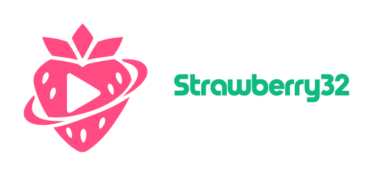

<p align="center">
  
</p>

<p align="center">
  <strong>Native, hardware-accelerated BitTorrent streaming media client built specifically for Windows RT 8.1 and ARM32 devices.</strong>
</p>

<p align="center">
  
  
  
  
  
</p>

---

## 🍓 Overview

**Strawberry32** is a dedicated streaming entertainment platform engineered from scratch for the Microsoft Surface RT (1st Gen), Surface 2, and other 32-bit ARM (ARMv7 / `thumbv7a`) Windows RT devices. 

By combining **Rust**, **Slint Software Rendering**, **librqbit**, and low-level **Windows Media Foundation** APIs, Strawberry32 bypasses modern web bloat, providing smooth 720p/1080p video playback and rich catalog exploration within a 2 GB RAM budget and low-power Tegra 3 SoC.

<!-- PLACEHOLDER: Main Application Showcase -->
> _<!-- [Screenshot Placeholder: Strawberry32 Home Screen with Hero Banner and Catalog Rows] -->_
> ``

---

## ✨ Features

- **⚡ Hardware-Accelerated Playback**:
  Streams video through Windows Media Foundation (`IMFPMediaPlayer`), utilizing NVIDIA Tegra 3 hardware H.264 (8-bit) decoding for buttery-smooth 720p and 1080p playback with negligible CPU load.
- **🔄 Intelligent Torrent Streaming Engine**:
  Powered by `librqbit 8.0` with dynamic container probing (`moov` atom for MP4 and `EBML/Cues` for MKV). Pre-fetches container headers and initial chunks so video starts buffering in seconds.
- **🌐 Full Stremio Add-on Ecosystem**:
  Directly compatible with Stremio v3 protocol add-ons (Cinemeta, Torrentio, CyberFlix, and custom community manifests).
- **🎨 Polished Touch-First Slint UI**:
  Features a responsive sidebar, rich hero banner, multi-row catalogs with lazy loading, and an embedded player overlay styled in deep obsidian (`#0e0e12`) and neon strawberry (`#ff4b82`).
- **💬 Subtitle Engine**:
  Transparent rounded subtitle container with zero UI jump, automatic subtitle selection by language, live timing sync adjustment (-250ms / +250ms), and custom font sizing.
- **🔍 Advanced Search, Filtering & Sorting**:
  Browse categories directly in Search, filter by Genre (Action, Comedy, Sci-Fi, Horror, etc.), sort by Rating, Year, Popularity, or Title with ascending/descending toggles.
- **💾 Low-Footprint Storage & Cache**:
  All telemetry, cache, and history are consolidated under `%LOCALAPPDATA%\Strawberry32`, with configurable torrent and image cache limits to protect device eMMC storage.

---

## 📸 Screenshots & Previews

<!-- PLACEHOLDER: Application Screenshots Gallery -->

| Home Catalog & Hero Banner | Search with Interactive Filter Chips |
| :---: | :---: |
| _<!-- [Screenshot: Home Catalog Row scrolling on Tegra 3] -->_<br>`` | _<!-- [Screenshot: Search tab with Genre and Sort chips] -->_<br>`` |

| Detail View & Stream Selection | In-Player Hardware Playback & Subtitles |
| :---: | :---: |
| _<!-- [Screenshot: Movie detail with MP4/MKV stream filters] -->_<br>`` | _<!-- [Screenshot: Hardware accelerated playback with transparent subtitle pill] -->_<br>`` |

---

## 🛠️ Architecture & Technical Stack

```
   ┌────────────────────────────────────────────────────────────┐
   │             Strawberry32 Slint User Interface               │
   │      (Pure Software Renderer - No D3D11 overhead)          │
   └───────────────┬────────────────────────────┬───────────────┘
                   │ User Events                │ Render Calls
                   ▼                            ▼
   ┌────────────────────────────────────────────────────────────┐
   │               Native Rust Application Core                 │
   │  ┌──────────────────────┐        ┌──────────────────────┐  │
   │  │   Addon Manager      │        │  Metadata Inspector  │  │
   │  │ (Cinemeta/Torrentio) │        │ (moov & EBML Cues)   │  │
   │  └──────────┬───────────┘        └──────────┬───────────┘  │
   │             │ Magnet Link                   │ Byte Ranges  │
   │             ▼                               ▼              │
   │  ┌──────────────────────────────────────────────────────┐  │
   │  │      librqbit BitTorrent Swarm Streaming Engine      │  │
   │  └──────────────────────────┬───────────────────────────┘  │
   │                             │ Local HTTP Server (3031)     │
   └─────────────────────────────┼──────────────────────────────┘
                                 │ HTTP Bytestream
                                 ▼
   ┌────────────────────────────────────────────────────────────┐
   │              Windows Media Foundation (MFP)                │
   │      NVIDIA Tegra 3 VPU Hardware H.264 Decoding            │
   └────────────────────────────────────────────────────────────┘
```

### Surface RT (Tegra 3) Engineering Constraints
1. **CPU/GPU Constraints**: NVIDIA Tegra 3 (Quad-core Cortex-A9 @ 1.3 GHz) lacks Direct3D 11 feature level support for modern GPU compositors. Strawberry32 utilizes the Slint Software Renderer, entirely eliminating D3D/DirectComposition crashes.
2. **Video Codec Compatibility**: Hardware decoding on Windows RT 8.1 supports 8-bit H.264 (AVC) up to 1080p. 10-bit HEVC/x265, HDR, and AV1 formats are filtered out by the stream qualification engine to prevent decode stutter.
3. **Memory Limits**: The application maintains a lean working set (< 150 MB typical RAM usage) ensuring it never causes memory paging on 2 GB RAM devices.

---

## 🚀 Building & Installation

### Prerequisites
- Windows 10/11 x64 host machine for cross-compilation (or native ARM32 developer environment).
- Rust toolchain (`stable` or `nightly`) with target:
  ```bash
  rustup target add thumbv7a-pc-windows-msvc
  ```
- Visual Studio Build Tools with ARM build components (`MSVC v143 - VS 2022 C++ ARM build tools`).
- LLVM / LLD linker (`cargo install -f lld` or MSVC `link.exe`).

### Compilation
Clone the repository and compile the release binary:
```bash
git clone https://github.com/your-username/Strawberry32.git
cd Strawberry32
cargo build --release --target thumbv7a-pc-windows-msvc
```

The resulting binary will be located at:
```
target/thumbv7a-pc-windows-msvc/release/Strawberry32.exe
```

### Deploying to Windows RT 8.1
1. Ensure your Surface RT / Windows RT device is jailbroken to run unsigned desktop applications (e.g. via the standard RT 8.1 Jailbreak / Testsigning tool).
2. Copy `Strawberry32.exe` to a folder on your device (e.g. `C:\Strawberry32\`).
3. Run `Strawberry32.exe`. On first launch, the app will initialize its local storage in `%LOCALAPPDATA%\Strawberry32` and pre-load default verified add-ons.

---

## 📜 Licensing

This project is licensed under the **GNU General Public License v3.0 (GPLv3)**.

### Technology Licensing Details
- **Slint UI**: Licensed under GPLv3 (for open-source desktop usage).
- **librqbit**: Licensed under the Apache License, Version 2.0.
- **stremio-native-stream-server modules**: Ported under the MIT License.

Because Slint is linked into the application under the terms of the GNU General Public License v3.0, the overall combined work is distributed under the **GPL-3.0-or-later**. See the [LICENSE](LICENSE) file for the full license text.

---

## 🙏 Credits & Acknowledgments

- **Slint**: Beautiful, efficient native GUI toolkit developed by [Slint Software](https://slint.dev/).
- **librqbit**: Lightweight BitTorrent client library written in Rust by [ikatson](https://github.com/ikatson/rqbit).
- **Stremio**: Open-source streaming system and add-on architecture by [Stremio Team](https://www.stremio.com/).
- **stremio-native-stream-server**: Reference torrent streaming pipeline by [perpetus](https://github.com/perpetus/stremio-native-stream-server).
- **Windows RT Community**: Dedicated enthusiasts keeping ARM32 devices functional and alive.

