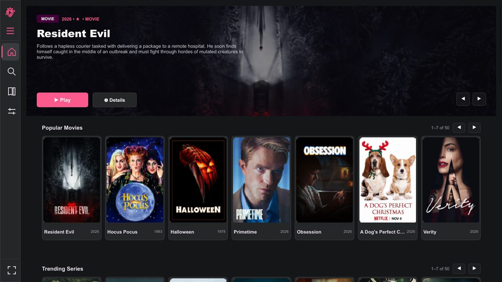
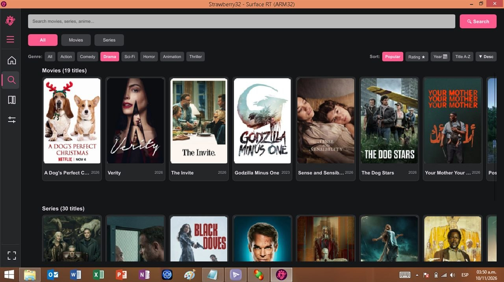
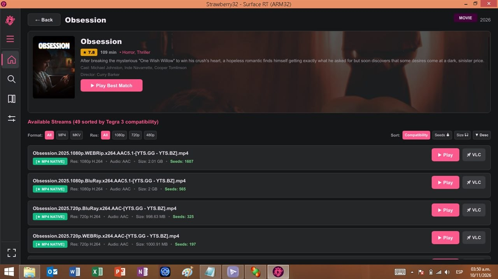
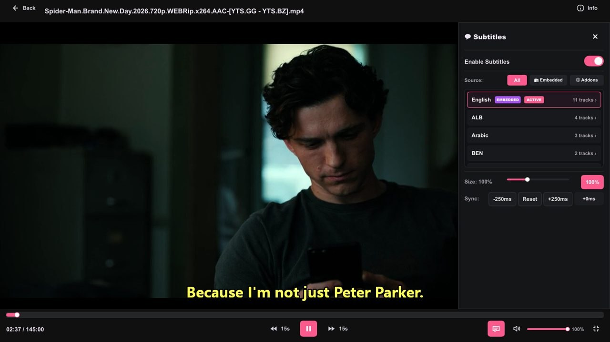
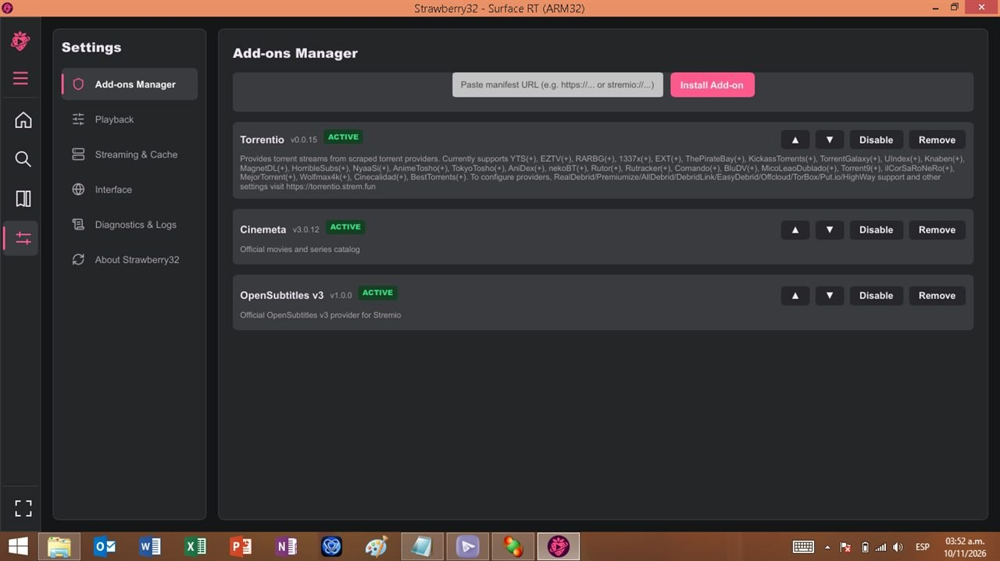
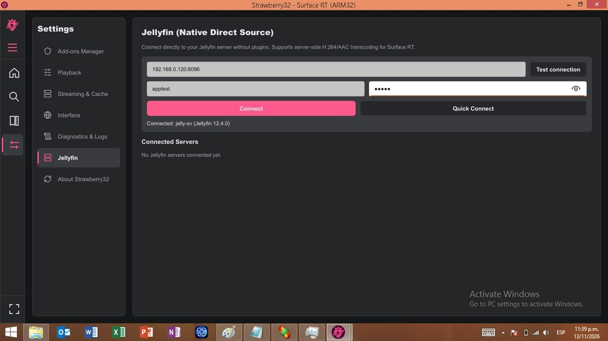

<p align="center">
  
</p>

<p align="center">
  <strong>Native, hardware-accelerated BitTorrent streaming media client built specifically for Windows RT 8.1 and ARM32 devices.</strong>
</p>

<p align="center">
  
  
  
  
  
</p>

---

## 🍓 Overview

**Strawberry32** is a dedicated streaming entertainment media player engineered from scratch for the Microsoft Surface RT (1st Gen), Surface 2, and other 32-bit ARM (ARMv7 / `thumbv7a`) Windows RT devices. 

By combining **Rust**, **Slint CPU Software Rendering**, **librqbit**, and low-level **Windows Media Foundation** APIs, Strawberry32 bypasses modern heavy web runtimes, delivering smooth 720p/1080p video playback and fluid catalog navigation within a tight 2 GB RAM budget and low-power Tegra 3 SoC.

<!-- Main Application Showcase -->
<p align="center">
  
</p>

---

## ✨ Features

- **⚡ Hardware-Accelerated Playback**:
  Streams video through Windows Media Foundation (`IMFPMediaPlayer`), utilizing NVIDIA Tegra 3 hardware H.264 (8-bit) decoding for fluid 720p and 1080p playback with negligible CPU load.
- **🔄 Intelligent Torrent Streaming Engine**:
  Powered by `librqbit 8.0` with dynamic container probing (`moov` atom for MP4 and `EBML/Cues` for MKV). Pre-fetches container headers and initial chunks so video starts buffering rapidly with multi-stage progress tracking.
- **🌐 Modular Stremio Add-on Protocol**:
  Compatible with standard Stremio v3 protocol add-ons. Users can connect modular add-on manifests via HTTP/HTTPS URLs to browse catalogs and stream sources.
- **🎬 Native Jellyfin Integration**:
  Connect directly to your personal Jellyfin server over your local network (LAN) or HTTPS—no plugins or IMDb IDs required. Automatically chooses between Direct Play and server-side H.264/AAC transcoding tailored for Tegra 3, merges Jellyfin sources onto Cinemeta cards with deduplication, and includes dedicated **Jellyfin Only** filters and Jellyfin subtitle support.
- **🎨 Touch & Keyboard-First Slint UI**:
  Obsidian dark theme (`#0e0e12`) with strawberry accents (`#ff4b82`), paged catalog rows with on-demand image decoding, collapsible details drawer, and native fullscreen support.
- **💬 Layered GDI Subtitle Engine**:
  Per-pixel alpha layered subtitle window with real-time scaling (50%–200%), live sync delay adjustment (-250ms / +250ms), and OpenSubtitles v3 integration.
- **🔍 Advanced Search, Filtering & Sorting**:
  Search movies and series, filter by Genre (Action, Comedy, Sci-Fi, Horror, etc.), sort by Rating, Year, Popularity, or Title with ascending/descending toggles.
- **⏮️ Continue Watching & Library**:
  Resumes recently played content directly from the Home screen or Library tab, storing watch progress locally.
- **💾 Low-Footprint Storage & Cache**:
  All telemetry, cache, logs, and settings are consolidated under `%LOCALAPPDATA%\Strawberry32`, with configurable disk limits to safeguard eMMC flash storage.

---

## 📸 Screenshots & Previews

| Home Catalog & Hero Banner | Search with Interactive Filter Chips |
| :---: | :---: |
| <br><sub>Featured Cinemeta catalog rows and high-res Hero Banner on Tegra 3</sub> | <br><sub>Dedicated Search tab with Genre and Sort chips and instant discovery</sub> |

| Detail View & Stream Selection | In-Player Hardware Playback & Subtitles |
| :---: | :---: |
| <br><sub>Cinemeta metadata, IMDb ratings, and smart stream compatibility badges</sub> | <br><sub>Windows Media Foundation H.264 hardware decoding with true transparent GDI subtitles</sub> |

<p align="center">
  <br/>
  <sub>Extensive Settings: Add-on manager with priority ordering, streaming limits, card sizing, and storage cache cleaner</sub>
</p>


## 🎬 Connecting to Jellyfin

<p align="center">
  <br/>
  <sub>Native Jellyfin Integration: Connect directly to your Jellyfin server via LAN IP or HTTPS with automatic Direct Play / server-side transcoding</sub>
</p>

Strawberry32 includes a built-in native Jellyfin client (no server-side plugins required):

1. **Find your Jellyfin server's LAN IP** on the machine hosting Jellyfin (for example, `http://192.168.0.120:8096`). If you are hosting on Windows, you can check your LAN IP using 'ipconfig'. You need to copy the IPv4 address.
2. Open **Settings → Jellyfin** in Strawberry32 (shown above):
   - Enter your **Server URL** (e.g. `http://192.168.0.120:8096`).
   - Enter your Jellyfin **Username** and **Password**, then click **Connect**.
3. Once connected, you can:
   - Browse and search your library (duplicate titles are automatically merged with Cinemeta cards, and you can toggle **Jellyfin Only** in Search).
   - Open any title and use the **Jellyfin** filter pill (highlighted in blue) to view your server's Direct Play or transcoded H.264/AAC streams, along with Jellyfin's embedded/external subtitles.

---

## ⌨️ Controls & Shortcuts

| Input | Action |
| :--- | :--- |
| **Space** | Play / Pause |
| **Left Arrow** / **Touch Double-Tap Left** | Seek Backward 10 seconds |
| **Right Arrow** / **Touch Double-Tap Right** | Seek Forward 10 seconds |
| **Up Arrow** | Increase Volume (+5%) |
| **Down Arrow** | Decrease Volume (-5%) |
| **F** / **Touch Double-Tap Center** | Toggle Fullscreen |
| **M** | Toggle Mute |
| **Escape** | Exit Fullscreen / Back |

---

## 🛠️ Architecture & Technical Stack

```
   ┌────────────────────────────────────────────────────────────┐
   │             Strawberry32 Slint User Interface               │
   │      (Pure Software Renderer - No D3D11 overhead)          │
   └───────────────┬────────────────────────────┬───────────────┘
                   │ User Events                │ Render Calls
                   ▼                            ▼
   ┌────────────────────────────────────────────────────────────┐
   │               Native Rust Application Core                 │
   │  ┌──────────────────────┐        ┌──────────────────────┐  │
   │  │   Addon Manager      │        │  Metadata Inspector  │  │
   │  │ (Stremio v3 Protocol)│        │ (moov & EBML Cues)   │  │
   │  └──────────┬───────────┘        └──────────┬───────────┘  │
   │             │ Stream Resource               │ Byte Ranges  │
   │             ▼                               ▼              │
   │  ┌──────────────────────────────────────────────────────┐  │
   │  │      librqbit BitTorrent Swarm Streaming Engine      │  │
   │  └──────────────────────────┬───────────────────────────┘  │
   │                             │ Local HTTP Server (3031)     │
   └─────────────────────────────┼──────────────────────────────┘
                                 │ HTTP Bytestream
                                 ▼
   ┌────────────────────────────────────────────────────────────┐
   │              Windows Media Foundation (MFP)                │
   │      NVIDIA Tegra 3 VPU Hardware H.264 Decoding            │
   └────────────────────────────────────────────────────────────┘
```

### Surface RT (Tegra 3) Engineering Constraints
1. **CPU/GPU Constraints**: NVIDIA Tegra 3 (Quad-core Cortex-A9 @ 1.3 GHz) lacks Direct3D 11 feature level support for modern GPU compositors. Strawberry32 utilizes the Slint Pure Software Renderer, eliminating GPU crashes and driver timeouts.
2. **Video Codec Compatibility**: Hardware decoding on Windows RT 8.1 supports 8-bit H.264 (AVC) up to 1080p. Incompatible streams (e.g. 10-bit HEVC/x265 or AV1) trigger a clear prompt to open in external VLC.
3. **Memory Limits**: The application maintains a lean working set (< 150 MB typical RAM usage) ensuring it never triggers aggressive memory paging on 2 GB RAM devices.

---

## 🚀 Building & Installation

### Prerequisites
- Windows 10/11 x64 host machine for cross-compilation (or native ARM32 developer environment).
- Rust toolchain (`stable` or `nightly`) with target:
  ```bash
  rustup target add thumbv7a-pc-windows-msvc
  ```
- Visual Studio Build Tools with ARM build components (`MSVC v143 - VS 2022 C++ ARM build tools`).
- LLVM / LLD linker (`cargo install -f lld` or MSVC `link.exe`).

### Compilation
Clone the repository and compile the release binary:
```bash
git clone https://github.com/your-username/Strawberry32.git
cd Strawberry32
cargo build --release --target thumbv7a-pc-windows-msvc
```

The resulting binary will be located at:
```
target/thumbv7a-pc-windows-msvc/release/Strawberry32.exe
```

### Deploying to Windows RT 8.1
1. Ensure your Surface RT / Windows RT device is jailbroken to run unsigned desktop applications (e.g. via the standard RT 8.1 Jailbreak / Testsigning tool).
2. Copy `Strawberry32.exe` to a folder on your device (e.g. `C:\Strawberry32\`).
3. Run `Strawberry32.exe`. On first launch, the app initializes its local storage in `%LOCALAPPDATA%\Strawberry32` and loads public metadata providers.

---

## ⚖️ Legal & Compliance Notice

Strawberry32 is an open-source media player and protocol client. 
- Strawberry32 does not host, index, archive, or distribute any media files, torrents, or streams.
- All metadata, catalog information, and subtitle data are provided via external third-party add-ons configured by the end user under standard Stremio v3 protocol specifications.
- Strawberry32 developers do not operate or endorse third-party add-on servers and are not responsible for content accessed by users.
- Users are solely responsible for ensuring that their use complies with all applicable local laws, regulations, and copyright requirements.

---

## 📜 Licensing

This project is licensed under the **GNU General Public License v3.0 (GPLv3)**.

### Technology Licensing Details
- **Slint UI**: Licensed under GPLv3 (for open-source desktop usage).
- **librqbit**: Licensed under the Apache License, Version 2.0.
- **stremio-native-stream-server modules**: Ported under the MIT License.

Because Slint is linked into the application under the terms of the GNU General Public License v3.0, the overall combined work is distributed under the **GPL-3.0-or-later**. See the [LICENSE](LICENSE) file for the full license text.

---

## 🙏 Credits & Acknowledgments

- **Slint**: Beautiful, efficient native GUI toolkit developed by [Slint Software](https://slint.dev/).
- **librqbit**: Lightweight BitTorrent client library written in Rust by [ikatson](https://github.com/ikatson/rqbit).
- **Stremio**: Open-source streaming system and add-on architecture by [Stremio Team](https://www.stremio.com/).
- **stremio-native-stream-server**: Reference torrent streaming pipeline by [perpetus](https://github.com/perpetus/stremio-native-stream-server).
- **Windows RT Community**: Dedicated enthusiasts keeping ARM32 devices functional and alive.
